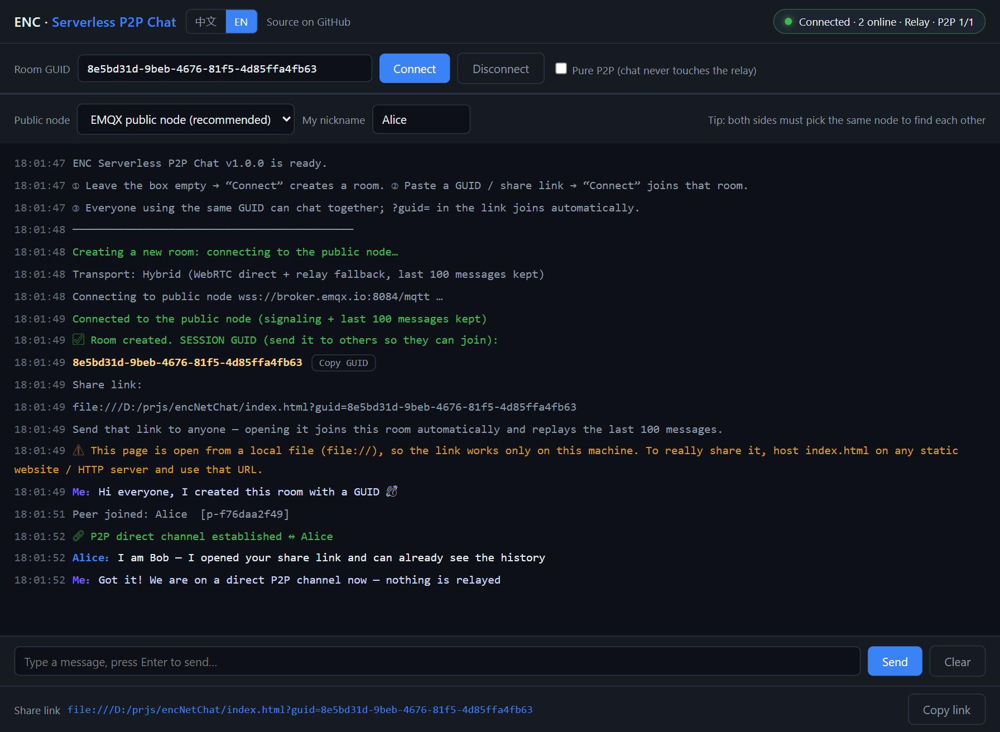

# AnonymouseChatWeb · ENC

**English** | [中文文档](README.zh-CN.md)

> A serverless P2P chat room that lives in **one single HTML file**.
> Share a GUID — or just a link — and chat peer-to-peer. There is no backend to deploy.

[](https://yashika.github.io/AnonymouseChatWeb/)
[](index.html)
[](index.html)
[](LICENSE)

**🚀 Live demo: <https://yashika.github.io/AnonymouseChatWeb/>**

<p align="center">
  
</p>

---

## What is it?

Open the page, leave the GUID box **empty** and hit **Connect** → a new room is created and you get a
**SESSION GUID**. Anyone who pastes that GUID (or opens your share link) lands in the same room.
Messages travel over a **WebRTC DataChannel** — a real peer-to-peer connection.

| Feature | |
|---|---|
| 🗂️ **One file** | `index.html` — no build step, no CDN, no `<script src>`, no npm install |
| 🔌 **No backend** | Signaling runs over free public MQTT brokers; there is no server of your own to deploy |
| 🌐 **Bilingual** | Full 中文 / English UI with a switcher, `?lang=zh` / `?lang=en`, and browser-language auto-detect |
| 🪪 **Remembered nickname** | One random nickname per browser, created on first visit and reused forever after |
| 🔗 **Shareable link** | `…/?guid=XXXXX` joins that room automatically |
| 📜 **Replay** | Everyone who joins sees the **last 100 messages** |
| 🕵️ **Pure P2P mode** | One checkbox: chat content then never touches the relay at all |
| 📦 **Zero dependencies** | Even the MQTT 3.1.1-over-WebSocket client is hand-written (~150 lines) |

<p align="center">
  <br>
  
</p>

---

## Quick start

### Try it hosted

```
https://yashika.github.io/AnonymouseChatWeb/
```

### Or run it locally

```bash
git clone https://github.com/yashika/AnonymouseChatWeb.git
cd AnonymouseChatWeb
# that's it — just open index.html in a browser
```

1. **First person** — leave the GUID box empty, click **Connect**. The log shows the SESSION GUID and a share link.
2. **Second person** — open the same page, paste that GUID into the box, click **Connect**.
   They immediately see the recent history.
3. **Or** just send them the share link — opening it joins the room automatically and replays the last 100 messages.

> Both sides must pick the **same public node** in the second row, otherwise they cannot see each other.

---

## Is this really "serverless"?

Almost — and it is important to be precise about it.

**WebRTC cannot work with zero infrastructure.** Two browsers must exchange SDP (capabilities) and
ICE (network candidates) before a peer-to-peer connection can exist. That handshake needs a third party
both sides can reach. That is exactly what
[RTCMultiConnection-Server](https://github.com/muaz-khan/RTCMultiConnection-Server) is: it is a
**Socket.io signaling server** (that package's only dependency is literally `socket.io`).
So with that project:

- ✅ **"P2P" is real** — media and data flow peer-to-peer; the server does not relay content.
- ❌ **"Serverless" is not** — without the signaling server, peers cannot even learn each other's addresses.

**This project keeps the P2P and drops the "deploy a server" part** by borrowing free public MQTT brokers
for signaling, and by using MQTT **retained messages** so the broker remembers the last 100 messages for you.
Chat content itself goes over a WebRTC DataChannel.

```
                 ┌───────────── public MQTT broker (wss) ─────────────┐
                 │  /s  signaling: SDP + ICE (only while connecting)  │
  Browser A ◄────┤  /p  presence heartbeat (who is in the room)       ├────► Browser B
                 │  /h  retained: last 100 messages (hybrid mode)     │
                 └────────────────────────────────────────────────────┘
     │                                                                      │
     └────────────── WebRTC DataChannel · the real P2P link ────────────────┘
```

---

## Two transport modes

Toggle **Pure P2P** in the toolbar:

| | Hybrid (default) | Pure P2P |
|---|---|---|
| Chat content travels via | WebRTC direct **+** relay fallback | **only** the WebRTC DataChannel |
| Late joiners see history | ✅ always (broker keeps the last 100) | ⚠️ only while a member is online (sent by a peer) |
| Message to an offline peer | ✅ stored, delivered when they return | ❌ lost |
| Chat content seen by the public broker | yes (plaintext) | no (broker only sees SDP/ICE) |
| If NAT traversal fails | automatic fallback to the relay | not delivered |

Hybrid sends each message over both paths and de-duplicates by message ID, so as long as either path works,
nothing is lost. That is the recommended default.

---

## Nickname

The nickname box is bound to the **browser/device**, not to the room:

- **First visit on a browser** → a random nickname such as `用户68e2` / `User1a3f` is generated,
  put in the box, and remembered immediately.
- **Every later visit** → that same nickname is restored as the default.
- **Edit it** → saved as soon as the field loses focus, and used for the messages you send next
  (even while you are already connected).
- **Clear the field** → the saved nickname is forgotten, so the next visit generates a fresh one.

It is written to `localStorage` **and** to a cookie, so clearing just one of them is not enough to
lose it. Only the nickname and the chosen public node are stored — no message content, no identifiers.

---

## Language / 语言

Three ways to choose the language:

1. The **中文 / EN** switcher in the header
2. The URL parameter: `?lang=zh` or `?lang=en`
3. Automatic detection from `navigator.language` (and the choice is remembered in `localStorage`)

Strings live in [`src/i18n.js`](src/i18n.js) — adding a language means adding one dictionary object.

---

## Deploy it yourself

`index.html` is pure static — host it anywhere:

```bash
# LAN
python -m http.server 8000     # → http://<your-ip>:8000/index.html
```

GitHub Pages, Netlify, Vercel, Cloudflare Pages, S3, any Nginx directory — all work.
**This repo already serves it from GitHub Pages**, straight from the `main` branch root.

> Note: a `file://` share link only works on your own machine, so host the file somewhere if you want
> to share it with other people. The page warns you about this automatically.

---

## Development

```
index.html            ← generated artifact (this is the whole app)
src/i18n.js           ← all UI strings, zh + en
src/core.js           ← minimal MQTT client, room logic, history, WebRTC mesh
src/app.js            ← DOM / UI logic
src/template.html     ← shell + CSS
src/build.mjs         ← inlines the three scripts into index.html
src/test-core.mjs     ← Node end-to-end test against real public brokers
src/test-browser.mjs  ← real Chrome + DevTools Protocol end-to-end test
src/shot.mjs          ← regenerates the screenshots in docs/
```

```bash
node src/build.mjs         # rebuild index.html after editing src/*
node src/test-core.mjs     # 15 assertions, needs network
node src/test-browser.mjs  # 47 assertions, needs Chrome on --remote-debugging-port=9222
```

Both suites currently pass completely — including a real WebRTC DataChannel in `open` state between two
browser tabs, the 100-message cap, and proof that Pure P2P content never reaches the relay.

---

## Limitations — please read before using it for anything serious

1. **Public brokers are public.** Anyone who knows the GUID can subscribe to the same topic and join.
   There is no authentication and no encryption. **Do not send sensitive information.**
   (You can add a layer of AES in `send()` / `accept()` in `src/core.js`.)
2. **There is no such thing as truly zero-infrastructure** in a browser. Signaling has to go through a
   third party; this project just swaps a self-hosted server for public MQTT brokers.
3. **History is capped at 100 messages**, and a single message at 4000 characters. Very large retained
   payloads are trimmed automatically.
4. **No TURN server.** In Pure P2P mode, symmetric NAT can prevent the direct connection
   (hybrid mode falls back to the relay and keeps working).
5. Public brokers may rate-limit or go down; the dropdown offers EMQX / HiveMQ / Mosquitto as alternatives.

---

## Acknowledgements

Inspired by [RTCMultiConnection](https://github.com/muaz-khan/RTCMultiConnection) and its
[signaling server](https://github.com/muaz-khan/RTCMultiConnection-Server) — the projects that made the
"P2P vs. serverless" question worth answering.

## License

[MIT](LICENSE)
