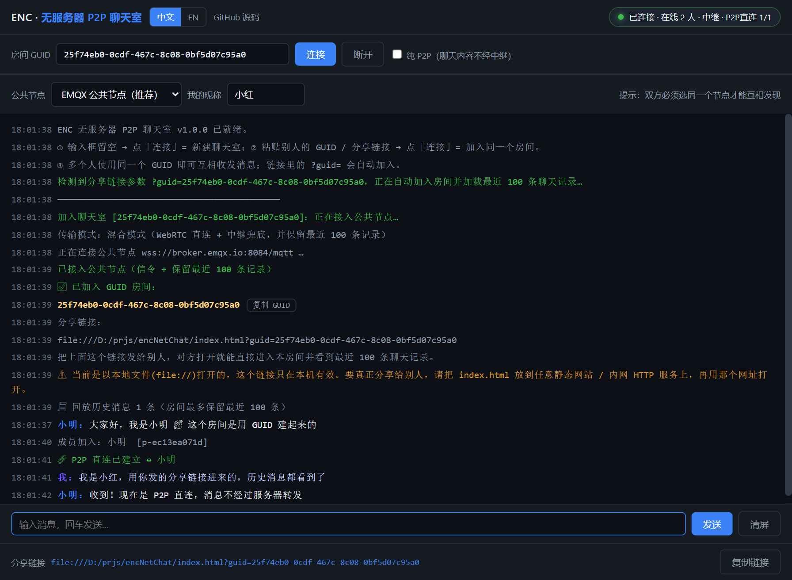
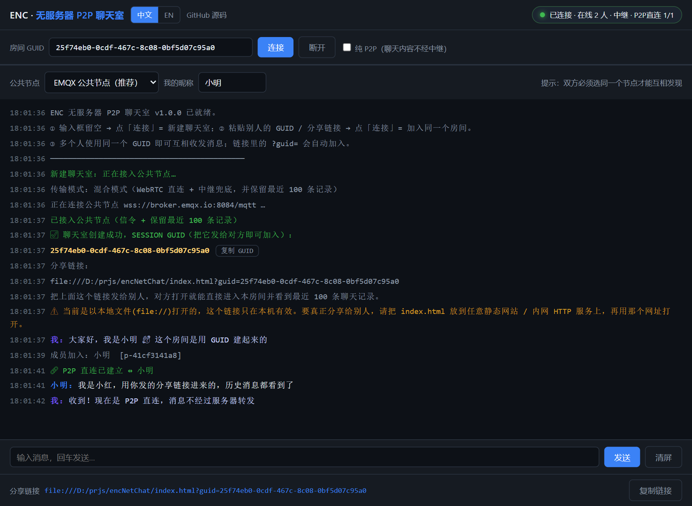
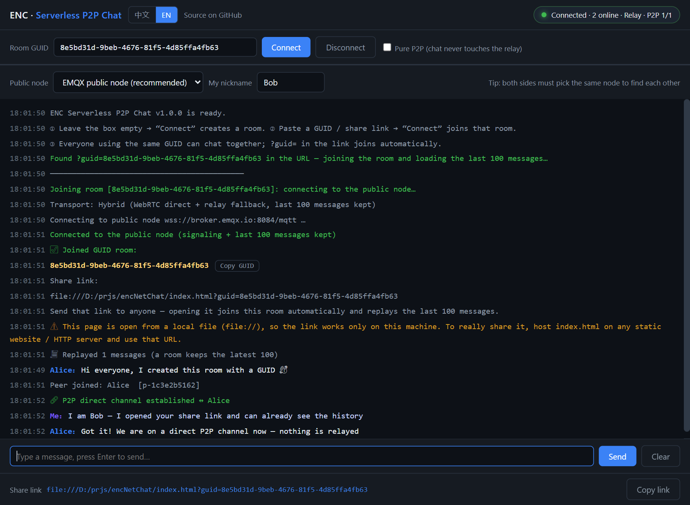

# AnonymouseChatWeb · ENC

[English](README.md) | **中文文档**

> 一个**只有单个 HTML 文件**的无服务器 P2P 聊天室。
> 分享一个 GUID —— 或者干脆分享一条链接 —— 就能点对点开聊，**不需要部署任何后端**。

[](https://yashika.github.io/AnonymouseChatWeb/)
[](index.html)
[](index.html)
[](LICENSE)

**🚀 在线演示：<https://yashika.github.io/AnonymouseChatWeb/>**

<p align="center">
  
</p>

---

## 这是什么？

打开页面，GUID 输入框**留空**，点 **「连接」** → 新建聊天室，你会拿到一个 **SESSION GUID**。
任何把这串 GUID 粘进输入框（或直接打开你的分享链接）的人，都会进入同一个房间。
消息通过 **WebRTC DataChannel** 传输，是真正的点对点连接。

| 特性 | 说明 |
|---|---|
| 🗂️ **单文件** | 只有 `index.html`，没有构建步骤、没有 CDN、没有 `<script src>`、不用 npm install |
| 🔌 **不需要后端** | 信令走免费公共 MQTT 节点，你没有自己的服务器要部署 |
| 🌐 **中英双语** | 完整的 中文 / English 界面，可切换，支持 `?lang=zh` / `?lang=en` 与浏览器语言自动识别 |
| 🔗 **可分享链接** | `…/?guid=XXXXX` 打开即自动加入该房间 |
| 📜 **历史回放** | 后加入的人能看到**最近 100 条**消息 |
| 🕵️ **纯 P2P 模式** | 一个勾选框，聊天内容完全不经过中继节点 |
| 📦 **零依赖** | 连 MQTT 3.1.1 over WebSocket 客户端都是手写的（约 150 行） |

<p align="center">
  <br>
  
</p>

---

## 快速开始

### 直接访问在线版

```
https://yashika.github.io/AnonymouseChatWeb/
```

### 或者本地运行

```bash
git clone https://github.com/yashika/AnonymouseChatWeb.git
cd AnonymouseChatWeb
# 就这样 —— 用浏览器打开 index.html 即可
```

1. **第一个人** —— GUID 输入框留空，点 **「连接」**。日志框会显示 SESSION GUID 和分享链接。
2. **第二个人** —— 打开同一个页面，把那串 GUID 粘进输入框，点 **「连接」**，立刻就能看到最近的聊天记录。
3. **或者** 直接把分享链接发给他 —— 打开就自动加入房间并回放最近 100 条消息。

> 双方必须在第二行的下拉框里选**同一个公共节点**，否则互相发现不了。

---

## 这真的「无服务器」吗？

**几乎是，但必须说清楚一个前提。**

**WebRTC 无法在零基础设施下工作。** 两个浏览器必须先交换 SDP（能力描述）和 ICE（网络候选地址），
才能建立点对点连接。这个握手必须经过一个双方都能访问的第三方。
[RTCMultiConnection-Server](https://github.com/muaz-khan/RTCMultiConnection-Server) 做的正是这件事——
它是一个 **Socket.io 信令服务器**（那个包的唯一依赖就是 `socket.io`）。所以：

- ✅ **「P2P」是真的** —— 媒体和数据走点对点，服务器不转发内容。
- ❌ **「无服务器」是假的** —— 没有信令服务器，双方连对方的地址都不知道，P2P 根本建立不起来。

**本项目保留了 P2P，同时去掉了「自己部署服务器」这一步**：信令借用免费的公共 MQTT 节点，
再用 MQTT 的**保留消息（retained）**让节点替我们记住最近 100 条。聊天内容本身走 WebRTC DataChannel。

```
                 ┌───────────── 公共 MQTT 节点 (wss) ─────────────────┐
                 │  /s  信令：SDP + ICE（只在建连时使用）              │
  浏览器 A ◄─────┤  /p  在线心跳（谁在房间里）                        ├─────► 浏览器 B
                 │  /h  保留消息：最近 100 条聊天记录（混合模式）      │
                 └────────────────────────────────────────────────────┘
     │                                                                      │
     └────────────── WebRTC DataChannel · 真正的 P2P 直连 ──────────────────┘
```

---

## 两种传输模式

工具栏上的 **「纯 P2P」** 勾选框可切换：

| | 混合模式（默认） | 纯 P2P 模式 |
|---|---|---|
| 聊天内容走哪 | WebRTC 直连 **+** 中继兜底 | **只走** WebRTC DataChannel |
| 后加入的人看到历史 | ✅ 任意时刻（节点保留最近 100 条） | ⚠️ 仅当有成员在线时由对方补发 |
| 给离线的人发消息 | ✅ 存进保留记录，对方上线能看到 | ❌ 直接丢失 |
| 公共节点是否看到聊天内容 | 是（明文） | 否（节点只看到 SDP/ICE 信令） |
| NAT 打洞失败时 | 自动降级为中继，照常可用 | 收不到 |

混合模式会把每条消息同时走两条通道，并按消息 ID 去重，所以只要有一条通就不会丢。这是推荐的默认方式。

---

## 语言切换

三种方式：

1. 页面右上角的 **中文 / EN** 按钮
2. URL 参数：`?lang=zh` 或 `?lang=en`
3. 依据 `navigator.language` 自动识别（选择会记在 `localStorage` 里）

所有文案都在 [`src/i18n.js`](src/i18n.js) 中，加一种语言 = 加一个字典对象。

---

## 自己部署

`index.html` 是纯静态文件，放哪儿都能跑：

```bash
# 局域网
python -m http.server 8000     # → http://<你的IP>:8000/index.html
```

GitHub Pages、Netlify、Vercel、Cloudflare Pages、S3、任意 Nginx 目录都行。
**本仓库已经用 GitHub Pages 托管**，直接发布 `main` 分支根目录。

> 注意：用 `file://` 打开的分享链接只在本机有效。要分享给别人，请把它放到一个网址上。
> 页面会自动提醒这一点。

---

## 开发

```
index.html            ← 构建产物（整个应用都在这一个文件里）
src/i18n.js           ← 全部界面文案（中 + 英）
src/core.js           ← 极简 MQTT 客户端、房间逻辑、历史、WebRTC 网状连接
src/app.js            ← DOM / 界面逻辑
src/template.html     ← 骨架与样式
src/build.mjs         ← 把三个脚本内联进 index.html
src/test-core.mjs     ← Node 端到端测试（真实公共节点）
src/test-browser.mjs  ← 真实 Chrome + DevTools 协议端到端测试
src/shot.mjs          ← 重新生成 docs/ 下的截图
```

```bash
node src/build.mjs         # 改完 src/* 后重新构建 index.html
node src/test-core.mjs     # 15 项断言，需要联网
node src/test-browser.mjs  # 47 项断言，需要 Chrome 开 --remote-debugging-port=9222
```

两套测试目前**全部通过** —— 包括两个浏览器标签页之间真实建立的 WebRTC DataChannel（状态 `open`）、
100 条上限，以及「纯 P2P 内容不会到达中继」的证明。

---

## 已知限制（认真使用前请务必阅读）

1. **公共节点是公开的。** 任何人只要知道 GUID，就能订阅同一个主题并加入房间。
   这里没有鉴权、没有加密，**请勿传输敏感信息**。
   （可以在 `src/core.js` 的 `send()` / `accept()` 里自行加一层 AES。）
2. **浏览器里不存在真正的「零基础设施」。** 信令必须经过第三方；本项目只是把自建服务器
   换成了公共 MQTT 节点。
3. **历史最多 100 条**，单条消息上限 4000 字符；保留消息过大时会自动裁剪更旧的记录。
4. **没有 TURN 服务器。** 纯 P2P 模式下对称型 NAT 可能打洞失败（混合模式会降级为中继，不受影响）。
5. 公共节点可能限流或临时不可用；下拉框里准备了 EMQX / HiveMQ / Mosquitto 三个备选。

---

## 致谢

灵感来自 [RTCMultiConnection](https://github.com/muaz-khan/RTCMultiConnection) 及其
[信令服务器](https://github.com/muaz-khan/RTCMultiConnection-Server) —— 正是它们让
「P2P 与无服务器」这个问题值得被认真回答。

## 许可证

[MIT](LICENSE)
